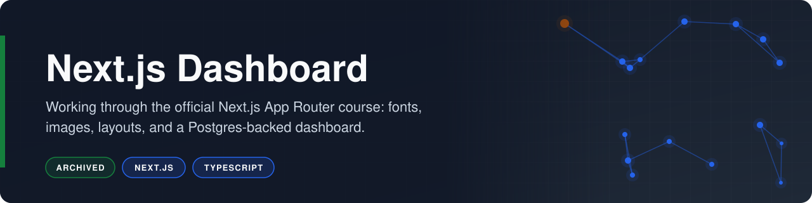
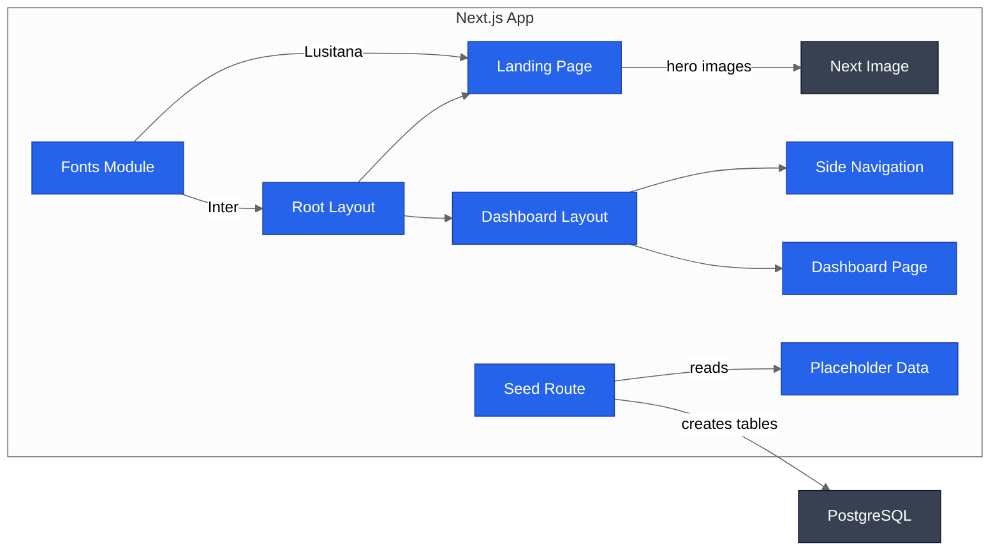

<p align="center"></p>

# Next.js Dashboard (Learning Project)

**Working through the official Next.js App Router course: fonts, images, layouts, and a Postgres-backed dashboard.**

    

This repository follows the official Next.js Learn "App Router" course, building the Acme invoicing dashboard chapter by chapter. The completed chapters deliver optimized font loading, responsive image delivery, and a persistent dashboard shell with side navigation.

## Overview

The starter code, placeholder data, and image assets come from Vercel's [Next.js Learn course](https://nextjs.org/learn) (source repository [`vercel/next-learn`](https://github.com/vercel/next-learn)). The template components for invoices, customers, dashboard cards, the revenue chart, skeletons, and the login form are Vercel's work and remain largely as the course provides them. The work in this repository is the course exercises completed so far, applied on top of that starter.

- **Font optimization:** `app/ui/fonts.ts` loads Inter and Lusitana through `next/font/google`, which self-hosts the font files at build time.
- **Responsive images:** `app/page.tsx` serves a desktop or mobile hero screenshot through `next/image`, chosen by Tailwind breakpoint classes.
- **Nested layouts:** `app/dashboard/layout.tsx` wraps every `/dashboard` route in a persistent side navigation.

## Business Case

### The Problem

Production dashboards depend on the full App Router toolset: nested layouts, streaming, Server Actions, authentication, and direct database access. Learning those pieces in isolation leaves gaps in how they fit together in one application. The official course is the canonical, end-to-end path to that skill set.

### Who It Serves

- **The author:** structured skill development on the current Next.js architecture, one chapter at a time.
- **Reviewers and collaborators:** a visible record of progress through a recognized curriculum, with each step in the commit history.

### The Outcome

The completed chapters produce a landing page with self-hosted fonts and breakpoint-aware hero images, plus a dashboard shell whose side navigation persists across routes. The remaining chapters (data fetching, streaming, search and pagination, mutations, and authentication) are listed under Roadmap.

## How It Works

The root layout applies the global font and styles, the landing page links into the dashboard, and the dashboard layout keeps the side navigation in place around each dashboard page.



1. **Load fonts:** `app/ui/fonts.ts` defines `inter` and `lusitana` with `next/font/google`.
2. **Apply global styles:** `app/layout.tsx` imports `app/ui/global.css` and sets Inter on the `body`.
3. **Render the landing page:** `app/page.tsx` shows the Acme hero with a Lusitana heading and a link into the app.
4. **Pick the hero image:** `next/image` serves `public/hero-desktop.png` from the `md` breakpoint up and `public/hero-mobile.png` below it.
5. **Wrap the dashboard:** `app/dashboard/layout.tsx` renders `SideNav` from `app/ui/dashboard/sidenav.tsx` beside each dashboard page.
6. **Show the dashboard page:** `app/dashboard/page.tsx` is the placeholder for the overview that later chapters fill in.
7. **Seed the database:** `app/seed/route.ts` (course template) creates and fills the users, customers, invoices, and revenue tables from `app/lib/placeholder-data.ts` on `GET /seed`.

## Tech Stack

| Layer | Technology | Purpose |
|---|---|---|
| Frontend | Next.js 15 (App Router) | Routing, nested layouts, font and image optimization |
| Frontend | React 19 | Component model and Server Components |
| Frontend | Tailwind CSS 3 | Utility-first styling and responsive breakpoints |
| Data | PostgreSQL via `postgres` | Invoice, customer, and revenue storage for later chapters |
| Backend | Route Handlers | Database seeding endpoint at `/seed` |
| Tooling | TypeScript 5 and pnpm | Type checking and dependency management |

## Getting Started

### Prerequisites

- Node.js 18.18 or later
- pnpm 9 or later
- A PostgreSQL database (only for seeding and the data chapters)

### Installation

1. Clone the repository.

   ```bash
   git clone https://github.com/risingOnIP/nextjs-dashboard-course.git
   cd nextjs-dashboard-course/nextjs-dashboard
   ```

2. Install dependencies from the lockfile.

   ```bash
   pnpm install
   ```

3. On pnpm 10, approve the native build for `bcrypt` and select it when prompted (pnpm 10 skips dependency build scripts by default, and the seed route needs `bcrypt`). pnpm 9 runs it automatically.

   ```bash
   pnpm approve-builds
   ```

4. Create a local environment file from the template.

   ```bash
   cp .env.example .env
   ```

### Configuration

| Variable | Required | Description |
|---|---|---|
| `POSTGRES_URL` | For `/seed` only | PostgreSQL connection string (`<your-database-url>`) |
| `POSTGRES_PRISMA_URL`, `POSTGRES_URL_NON_POOLING`, `POSTGRES_USER`, `POSTGRES_HOST`, `POSTGRES_PASSWORD`, `POSTGRES_DATABASE` | No | Provided by the course's hosted Postgres setup; not read by the current code |
| `AUTH_SECRET` | No | Secret for the authentication chapter; generate with `openssl rand -base64 32` |
| `AUTH_URL` | No | Authentication base URL for the authentication chapter; the template sets `http://localhost:3000/api/auth` |

The landing page, the dashboard shell, and `next build` run without any of these variables. `POSTGRES_URL` is read at request time by `app/seed/route.ts`.

### Usage

```bash
pnpm dev
```

Open `http://localhost:3000` to see the landing page, and `http://localhost:3000/dashboard` to see the dashboard shell with side navigation. With `POSTGRES_URL` set, request `http://localhost:3000/seed` once to create and fill the course tables.

To create a production build:

```bash
pnpm build
pnpm start
```

## Project Structure

```text
nextjs-dashboard-course/
├── nextjs-dashboard/
│   ├── app/
│   │   ├── dashboard/
│   │   │   ├── layout.tsx     # dashboard shell with side navigation
│   │   │   └── page.tsx       # dashboard placeholder page
│   │   ├── lib/               # course data layer, types, utilities
│   │   ├── query/route.ts     # course exercise route
│   │   ├── seed/route.ts      # course database seeding route
│   │   ├── ui/
│   │   │   ├── dashboard/     # side navigation and dashboard widgets
│   │   │   ├── invoices/      # course invoice components
│   │   │   ├── customers/     # course customer table
│   │   │   ├── acme-logo.tsx  # logo using the Lusitana font
│   │   │   ├── fonts.ts       # Inter and Lusitana font definitions
│   │   │   └── global.css     # Tailwind base styles
│   │   ├── layout.tsx         # root layout applying Inter
│   │   └── page.tsx           # landing page with responsive hero
│   ├── public/                # hero images and customer avatars
│   ├── .env.example           # environment variable template
│   ├── next.config.ts
│   ├── package.json
│   ├── tailwind.config.ts
│   └── tsconfig.json
├── LICENSE
└── README.md
```

## Notes

- The application lives in the `nextjs-dashboard/` subfolder, matching the course starter layout.
- The template's data-driven components (dashboard cards, revenue chart, latest invoices, and the invoice and customer tables) are connected to routes in later course chapters, listed under Roadmap.
- The committed `pnpm-lock.yaml` resolves Next.js 15.1.6 and React 19.0.0; install from the lockfile to reproduce that environment.

## Roadmap

- [ ] Add data fetching for the dashboard cards, revenue chart, and latest invoices from PostgreSQL.
- [ ] Add streaming with React Suspense and the template's loading skeletons.
- [ ] Add the invoices page with search, pagination, and Server Actions for create, update, and delete.
- [ ] Add error handling, form validation, and accessibility improvements from the course.
- [ ] Add authentication with NextAuth.js to protect the dashboard routes.
- [ ] Pin `next`, `react`, and `react-dom` to explicit versions.

## Acknowledgments

- Starter code, placeholder data, and image assets come from the [Next.js Learn course](https://nextjs.org/learn) by Vercel, Inc.
- Source repository: [`vercel/next-learn`](https://github.com/vercel/next-learn), published under the MIT License.

## License

Released under the [MIT License](LICENSE).

## Author

Developed by [Karthik Kaligotla](https://github.com/risingOnIP), named inventor on U.S. Patents [12,445,488 B2](https://patents.google.com/patent/US12445488B2/) and [12,598,158 B2](https://patents.google.com/patent/US12598158B2/).
